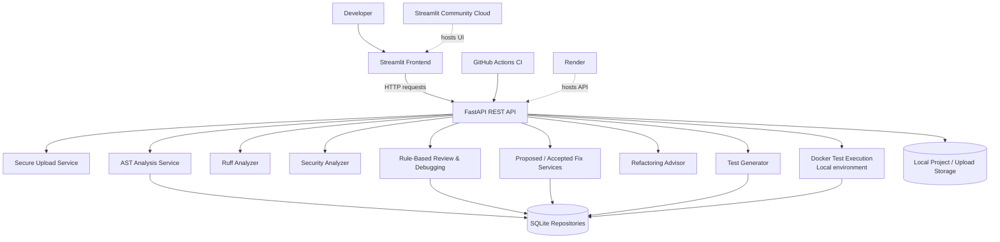

# 🚀 DevPilot AI
### AI-Assisted Code Analysis, Debugging & Testing Workspace

DevPilot AI is a Python developer assistant that helps inspect uploaded code, identify common quality and security risks, understand issues, explore refactoring opportunities, and generate starter tests.

It combines a **Streamlit interface**, a **FastAPI backend**, static Python analysis, deterministic review rules, and a SQLite persistence layer.

> **Project status:** Public demo deployment. The hosted version is intended for demonstration and evaluation, not as a production security-auditing or untrusted-code execution service.

---

## ✨ Features

| Feature | What it does |
|---|---|
| Project Upload | Accepts Python files and ZIP projects with upload validation and extraction safeguards. |
| Static Code Analysis | Parses Python with the AST and integrates Ruff findings for selected lint and correctness rules. |
| Security Scanning | Flags selected risky patterns such as hardcoded-secret-like values, SQL construction, `shell=True`, unsafe pickle loading, and weak hashes. |
| Code Review & Debugging | Adds rule-based explanations, source context, likely root causes, debugging steps, and suggested fixes. |
| Proposed Fixes | Previews supported deterministic fixes and diffs without modifying the uploaded original. |
| Refactoring Advisor | Provides guidance for selected complexity, long-function, and duplicate-code findings. |
| Test Generation | Inspects Python functions with AST and generates basic pytest existence/callability tests. |
| Test Execution | Runs generated tests in a restricted local Docker container. |
| Project History & Reports | Persists and displays analysis, review, generated-test, accepted-fix, and execution history where storage is available. |
| Dashboard | Summarizes analysis, test, and security metrics. |

### Important implementation notes

- The current code-review engine uses **offline, rule-based templates**. It does not require a paid LLM API.
- Security findings are **heuristic pattern detections**, not a complete security audit. False positives and false negatives are possible.
- The generated tests are starter tests. They do not prove business-logic correctness or comprehensive coverage.
- Hosted Docker-based test execution is not enabled; use the local setup for the Docker Test Runner.
- Free hosting filesystems can be ephemeral. Do not rely on the public demo to retain uploads, accepted fixes, or SQLite history permanently.

---

## 🧱 Architecture



### Request flow

1. A user uploads a Python file or ZIP project through Streamlit.
2. The frontend sends the file to FastAPI.
3. The backend validates the upload and stores it in the project workspace.
4. Analysis services inspect source code without executing it.
5. Results are returned to the frontend and persisted in SQLite.
6. The user can inspect findings, review explanations, proposed fixes, refactoring guidance, and generated tests.
7. Locally, generated tests can be executed inside a restricted Docker container.

---

## 🛠️ Tech Stack

**Frontend**
- Python
- Streamlit
- Requests
- Custom CSS

**Backend**
- Python 3.11
- FastAPI
- Pydantic Settings
- REST APIs

**Analysis & Testing**
- Python AST
- Ruff
- Pytest
- Docker (local test execution)

**Persistence & Delivery**
- SQLite
- Git and GitHub
- GitHub Actions
- Render (backend hosting)
- Streamlit Community Cloud (frontend hosting)

---

## 📁 Project Structure

```text
DevPilot-AI/
├── backend/
│   ├── app/
│   │   ├── api/
│   │   │   └── routes/
│   │   ├── core/
│   │   ├── db/
│   │   ├── repositories/
│   │   ├── schemas/
│   │   └── services/
│   ├── tests/
│   └── requirements.txt
├── frontend/
│   ├── app.py
│   └── requirements.txt
├── .github/
│   └── workflows/
│       └── ci.yml
├── data/                  # Runtime data; not committed
├── render.yaml
├── requirements.txt
├── .env.example
├── .gitignore
└── README.md
```

---

## ⚙️ Run Locally

### 1. Clone the repository

```bash
git clone https://github.com/sneha140305/DevPilot-AI.git
cd DevPilot-AI
```

### 2. Create and activate a virtual environment

**Windows PowerShell**
```powershell
python -m venv .venv
.venv\Scripts\Activate.ps1
```

**macOS / Linux**
```bash
python3 -m venv .venv
source .venv/bin/activate
```

### 3. Install dependencies

```bash
python -m pip install --upgrade pip
pip install -r requirements.txt
```

### 4. Start the backend

From the repository root:

```bash
uvicorn app.main:app --app-dir backend --reload
```

Backend:
- API root: `http://127.0.0.1:8000/`
- Health: `http://127.0.0.1:8000/api/v1/health`
- Swagger docs: `http://127.0.0.1:8000/docs`

### 5. Start the frontend

Open a second terminal, activate the same virtual environment, then run:

```powershell
$env:DEVPILOT_API_URL="http://127.0.0.1:8000"
streamlit run frontend/app.py
```

On macOS / Linux:

```bash
export DEVPILOT_API_URL="http://127.0.0.1:8000"
streamlit run frontend/app.py
```

---

## 🧪 Run Quality Checks

From the repository root:

```bash
ruff check backend/app backend/tests
python -m compileall -q backend/app
python -m py_compile frontend/app.py
python -m pytest backend/tests -v
```

The latest validation reported by the project maintainer was **220 tests passed**, with one non-blocking Starlette/httpx deprecation warning. Re-run the commands above against the current commit to verify the latest state.

---

## 🌐 Live Demo

- **Frontend:** https://devpilot-ai-t7s3edqr7tah832dnpazcz.streamlit.app/
- **Backend:** https://devpilot-ai-41r0.onrender.com/
- **API documentation:** https://devpilot-ai-41r0.onrender.com/docs
- **Health endpoint:** https://devpilot-ai-41r0.onrender.com/api/v1/health

The free backend may spin down after inactivity. Its local filesystem is ephemeral, so uploaded files, accepted-fix files, and SQLite history may not persist across restarts or redeployments.

---

## 🔐 Security & Execution Boundaries

- Uploaded Python source is parsed and analyzed statically; analysis does not execute the uploaded source.
- ZIP extraction applies path and size checks.
- Proposed fixes are previews and accepted versions are stored separately from the original source.
- The local Docker test runner uses restrictive container settings, including disabled networking, read-only workspace mounting, resource limits, dropped capabilities, and a non-root user.
- Do not upload confidential source code, real credentials, personal data, or production secrets to the public demo.
- Security scanning is a best-effort heuristic and must not replace professional security review.

---

## 🗺️ Roadmap

Potential next improvements:

- Persistent managed storage for hosted projects and history.
- More comprehensive multi-file project and dependency-aware test generation.
- Stronger semantic and data-flow security analysis.
- More robust test execution service with isolated hosted workers.
- Authentication, per-user project isolation, quotas, and audit logging.
- Expanded test coverage and deployment monitoring.

---

## 👩‍💻 Author

**Sneha Choudhary**

- GitHub: https://github.com/sneha140305

---

## 📄 License

This project is distributed under the MIT License. See [LICENSE](LICENSE).